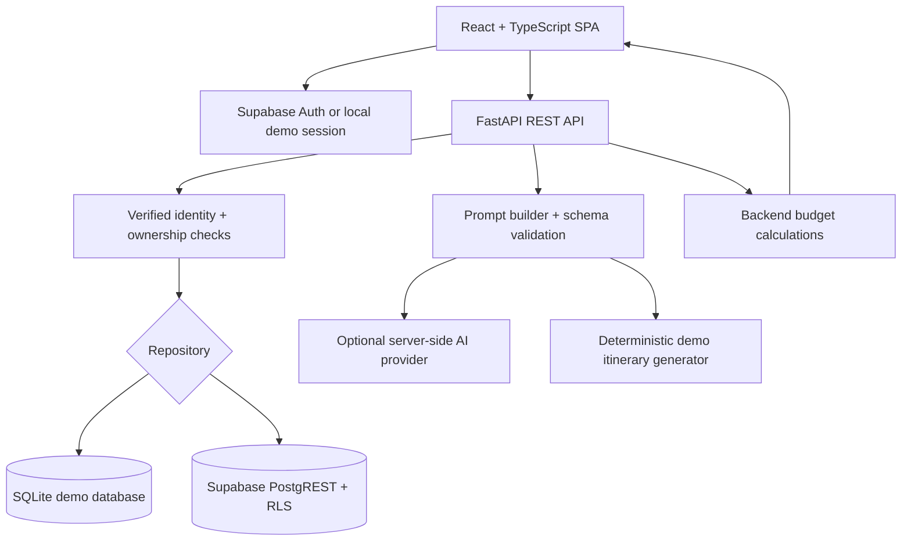

# Wayfarer — Personalized Travel Itinerary Planner

A full-stack travel-planning application that turns a destination, dates, budget, group size, interests, and travel preferences into an editable day-by-day itinerary. It includes a React/TypeScript frontend, FastAPI backend, persistent local demo mode, optional Supabase authentication/storage, structured AI generation, budget calculations, export, and expiring read-only share links.

> **Data honesty:** The default credential-free demo generates illustrative ideas and cost estimates. It does not look up live venues, addresses, opening hours, ratings, prices, routes, reservations, or hotel availability. A generated itinerary is a planning aid, not a booking confirmation.

## Problem statement
Trip planning usually means juggling search tabs, notes, budgets, opening-hour checks, transport research, and group preferences. Wayfarer centralizes preference capture, itinerary suggestions, edits, cost estimates, and share/export flows in a single responsive workspace.

## Objectives
- Capture travel preferences in a validated form.
- Generate an itinerary for every selected calendar day.
- Personalize by interests, pace, occasion, dietary needs, group size, accommodation, and budget.
- Let travelers edit/reorder activities and preserve their edits during regeneration.
- Calculate costs from structured data rather than model-provided totals.
- Support secure user-owned trips, read-only sharing, and portable exports.
- Be understandable to students and straightforward to run, test, and deploy.

## Main features
- Responsive marketing landing page, Supabase sign-up/sign-in and password recovery support, plus a demo sign-in for local development.
- Trip builder for date range, destination, currency, budget, travelers, style, interests, dining, diet, accommodation, transport, occasion, accessibility and custom notes.
- Dashboard with search, saved trip cards, duplication and deletion.
- Day-by-day activity editor: add, edit, remove, mark complete, reorder, regenerate one day, and regenerate the full itinerary.
- Budget breakdown with activity, food, transport, other and separate accommodation estimates; total and per-person calculations are performed in backend code.
- JSON and Markdown download, browser print, and opt-in read-only links with token hashing, expiry and revocation.
- SQLite persistence for the local demo; optional Supabase Auth + PostgREST integration with RLS in configured use.
- FastAPI-generated OpenAPI documentation, unit/integration tests, Ruff, Vitest, TypeScript checks and GitHub Actions CI.

## User scenarios
1. **Solo weekend:** a traveler with limited research time creates a date-bounded itinerary shaped by food/sightseeing interests and budget, then edits and exports it.
2. **Couple's vacation:** romantic/scenic preferences and a relaxed pace influence suggestions; estimated costs update after edits, and the itinerary can be regenerated without discarding marked edits.
3. **Small group:** group size and shared trip budget are modeled; per-person estimates are shown and a secure read-only link can be shared. Real-time collaboration is not implemented.

## Technology stack
- Frontend: React 18, TypeScript, Vite, React Router, Lucide React, custom responsive CSS, optional `@supabase/supabase-js`.
- Backend: Python 3.12+, FastAPI, Pydantic v2, HTTPX, SQLite for local demo, optional Supabase PostgREST/Auth.
- AI: configurable OpenAI-compatible Chat Completions API. AI calls originate only from the backend.
- Database: SQLite locally; PostgreSQL/Supabase with JSONB, indexes, foreign keys and Row Level Security when configured.
- Hosting preparation: Render (`render.yaml`) + Vercel (`frontend/vercel.json`).

## Architecture


## Repository layout
```text
personalized-travel-itinerary-planner/
├── frontend/                 # Vite app, pages, styles, tests, Vercel SPA config
├── backend/app/              # FastAPI routes, Pydantic schemas, services, repository
├── backend/tests/             # pytest API/service tests
├── supabase/migrations/       # Postgres schema, RLS, secure share RPC
├── supabase/seed.sql          # Development-only sample SQL template
├── docs/                      # Architecture, database, API, deployment, activity checklist
├── .github/workflows/ci.yml   # Automated validation
├── AGENTS.md / CLAUDE.md      # Coding-agent instructions
├── render.yaml                # Render service blueprint
├── scripts/                   # Windows setup and local launch helpers
└── README.md
```

See [`docs/college-submission-report.md`](docs/college-submission-report.md) for the project report, architecture, implementation, testing evidence, limitations, and conclusion.

## Screenshots
No screenshots have been captured from a running browser as part of this handoff. Capture the landing page, dashboard, builder, itinerary, and budget overview after running the application and place them in `docs/screenshots/` before adding real screenshot links here.

## Prerequisites
- Node.js 20+ and npm.
- Python 3.12+ recommended.
- Git.
- Optional: Supabase project and a compatible AI provider API key.
- Optional editor: VS Code, Cursor, or Claude Code. The repository includes `AGENTS.md` and `CLAUDE.md` instructions.

## Local setup (demo mode)

### Windows PowerShell (quickest)
From the repository root, run the included setup script once, then the launcher:

```powershell
Set-ExecutionPolicy -Scope Process -ExecutionPolicy Bypass
.\scripts\setup-windows.ps1
.\scripts\start-windows.ps1
```

The setup script creates the Python virtual environment, installs backend and frontend dependencies, and creates local environment files from the examples. The launcher opens separate backend and frontend terminals. If npm installation fails because the registry is unreachable, check your internet/proxy settings and rerun the setup script.

### Manual setup (Windows, macOS, or Linux)
Open two terminals from the repository root.

### 1. Backend
```bash
cd backend
python -m venv .venv
# macOS/Linux
source .venv/bin/activate
# Windows PowerShell: .venv\Scripts\Activate.ps1
pip install -r requirements.txt
cp .env.example .env  # Windows: Copy-Item .env.example .env
uvicorn app.main:app --reload --host 127.0.0.1 --port 8000
```

The backend defaults run with `DEMO_MODE=true` and store trips in `backend/travel_planner.db` when started from the backend directory. Use `DEMO_MODE=false` with Supabase settings to use remote Supabase storage; in production, an AI key and deployed CORS origins are required. API docs: http://127.0.0.1:8000/docs. Health: http://127.0.0.1:8000/api/v1/health.

### 2. Frontend
```bash
cd frontend
npm install
cp .env.example .env.local
npm run dev
```

Open http://localhost:5173 and select **Continue in demo mode**. Demo trips are persisted in the backend's local SQLite database, so they remain after a page refresh. Anyone with access to the demo service shares the same local demo identity; this is for local development only and must not be enabled in production.

## Environment variables

| Variable | Where | Purpose |
|---|---|---|
| `APP_ENV` | Backend only | `development` or `production`; production validation blocks demo mode. |
| `FRONTEND_URL` | Backend only | Primary frontend origin for CORS. |
| `ALLOWED_ORIGINS` | Backend only | Comma-separated exact allowed frontend origins. |
| `DATABASE_PATH` | Backend only | SQLite path for local demo use. Not production persistence. |
| `DEMO_MODE` | Backend only | Enables deterministic local demo token and sample generator. Must be false in production. |
| `MAX_TRIP_DAYS` | Backend only | Configurable generation duration limit (default 21 days). |
| `MAX_GENERATION_REQUESTS_PER_MINUTE` | Backend only | Per-user generation limit per minute per API process. |
| `REQUEST_TIMEOUT_SECONDS` | Backend only | Outbound service timeout. |
| `AI_PROVIDER`, `AI_API_KEY`, `AI_MODEL`, `AI_BASE_URL` | Backend only | Optional OpenAI-compatible provider configuration; API key is a server secret. |
| `SUPABASE_URL` | Backend only | Supabase project URL for auth validation and PostgREST. |
| `SUPABASE_PUBLISHABLE_KEY` | Backend and frontend | Supabase publishable/anon key; safe for browser use when RLS is correctly configured. Never use the service-role/secret key here. |
| `VITE_API_BASE_URL` | Frontend only | Backend base URL. Defaults to `http://localhost:8000`. |
| `VITE_SUPABASE_URL` | Frontend only | Supabase URL for browser auth. |
| `VITE_SUPABASE_PUBLISHABLE_KEY` | Frontend only | Public/publishable Supabase key for browser auth. |

Copy the root `.env.example` values into `backend/.env` and `frontend/.env.local` as needed. The Vite `.env.local` file must contain only `VITE_` browser-safe values. Never put `AI_API_KEY`, a Supabase secret/service-role key, database password or production credential in a `VITE_` variable, source file, AI instruction file, or Git commit.

## Supabase setup
1. Create a Supabase project and enable email/password in **Authentication → Providers**.
2. Add local and deployed frontend URLs under **Authentication → URL Configuration**.
3. Copy the project URL and publishable key into the backend environment and the browser-safe values into `frontend/.env.local`.
4. Apply `supabase/migrations/202610290001_initial_schema.sql` using the Supabase SQL Editor or CLI (`supabase login`, `supabase link --project-ref <project-ref>`, `supabase db push`). Review the migration before applying it to any existing database.
5. Set backend `DEMO_MODE=false`, `APP_ENV=production`, and exact `FRONTEND_URL`/`ALLOWED_ORIGINS` values. Start the API and verify `/api/v1/health`.
6. Sign up in the frontend, create a trip, refresh, then verify it still exists. Test access using two separate test accounts to prove owner boundaries.

Local demo mode does not require Supabase. The browser demo token is deliberately rejected when `DEMO_MODE=false`.

## AI provider configuration
- Add the provider API key to `backend/.env` only.
- Set `AI_PROVIDER=openai-compatible`, `AI_BASE_URL` (base API URL ending before `/chat/completions`), and `AI_MODEL` to a supported model.
- Restart the backend and create a new trip. The backend asks for JSON and validates all day/activity fields before persistence.
- If no key is configured while demo mode is on, a deterministic itinerary is generated and clearly labeled `demo_estimate`. If a configured AI provider errors or returns an invalid schema, the app reports the failure rather than silently describing fake data as live or successful.

## Reproducible frontend installs

The frontend package versions are pinned in `frontend/package.json`. A generated `package-lock.json` is not included in this handoff because DNS resolution for `registry.npmjs.org` failed from the build environment. On a network-enabled machine, run `cd frontend && npm install`, review and commit the resulting `package-lock.json`, then use `npm ci` for repeatable local and CI installs. The current CI workflow uses `npm install` until that lockfile is added.

## Demo and viva walkthrough

See [`docs/demo-and-viva.md`](docs/demo-and-viva.md) for a repeatable demo scenario, architecture explanation, likely viva questions, and clear statements about current live-data limitations.

## Commands and checks

Latest backend regression run: **32 passed**. Frontend syntax parsing completed for 17 TS/TSX source and test files, but the frontend typecheck, lint, unit test run, and production build have not yet been verified because the npm registry hostname could not be resolved in the build environment. Run the commands below after installing dependencies on a network-enabled machine; do not treat a source syntax check as a successful production build.
```bash
# Backend
cd backend
pip install -r requirements.txt
ruff check app tests
pytest -q

# Frontend
cd ../frontend
npm install
npm run typecheck
npm run lint
npm test
npm run build
```


A local HTTP smoke test was also run against FastAPI with a temporary SQLite database: health, create, generate, list, JSON export, share/read/revoke, duplicate, and delete all returned their expected HTTP statuses. This does not replace browser testing or live Supabase/AI/deployment verification.

## Run the complete Windows verification suite

After setup has completed successfully, run this from the project root in PowerShell:

```powershell
.\scripts\verify-windows.ps1
```

It runs Ruff, backend pytest, frontend TypeScript checking (including test files), ESLint, Vitest, and the Vite production build. The script stops at the first failed check; do not submit a failed build as a passing result.

## Deploy to Render and Vercel
See [`docs/deployment.md`](docs/deployment.md). Render uses root `render.yaml` and requires production settings plus Supabase. Vercel's project root should be `frontend`; set `VITE_API_BASE_URL`, `VITE_SUPABASE_URL`, and `VITE_SUPABASE_PUBLISHABLE_KEY`. Configure exact CORS origins on Render after obtaining the real Vercel URL. Deployment has not been performed or verified by this repository build.

## Security and privacy notes
- Local demo is not a multi-tenant production auth solution; never deploy it publicly with `DEMO_MODE=true`.
- Backend token identity is verified with Supabase Auth before using Supabase storage; the client does not trust unverified JWT decoding.
- Supabase RLS policies scope each private row to `auth.uid()`.
- The server uses the public/publishable key and user access token for REST calls rather than a service-role key.
- Share links use random tokens, store SHA-256 hashes, expire within 90 days, can be revoked, and expose a limited read-only projection.
- The itinerary generator sends destination/dates/budget and selected preferences to the configured AI provider. Do not include sensitive details in free-text instructions.
- Costs, itineraries, and attraction ideas are not bookings or guarantees. Check official sources before paying or travelling.

## Known limitations
- Live place search, geocoding, route distance/time optimization, opening hours, ratings, reservation status, hotel availability and dynamic ticket prices are not integrated.
- Recommendation results are preference-matched category prompts, not independently verified place listings.
- The Supabase migration and REST adapter are prepared but require live credentials and end-to-end verification.
- Simultaneous multi-user collaboration is not implemented; public sharing is read-only.
- Generation has a per-process in-memory limit; production abuse monitoring and distributed/edge rate limiting need additional hardening before a public service launch.
- Production deployment and live provider checks were not performed in this environment.

## Troubleshooting
- **Could not reach planner API:** start the backend and check `VITE_API_BASE_URL`.
- **401 on trip routes:** demo token requires backend `DEMO_MODE=true`; Supabase mode requires a valid signed-in session and matching project URL/key.
- **Database schema error:** apply the migration and inspect Supabase RLS policies.
- **AI generation error:** check the server-side key, model, API base URL, provider JSON-mode support and outbound network connectivity. The key must never be placed in the frontend.
- **Share link error on Supabase:** confirm the migration includes `get_shared_trip(text)` and its public execute grant.

## Contributing
See [`CONTRIBUTING.md`](CONTRIBUTING.md). Coding-agent rules are in [`AGENTS.md`](AGENTS.md) and [`CLAUDE.md`](CLAUDE.md).

## License
MIT. See [`LICENSE`](LICENSE).
